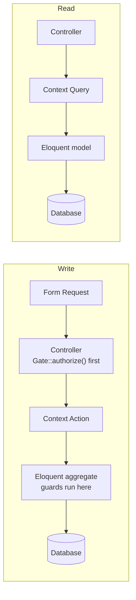
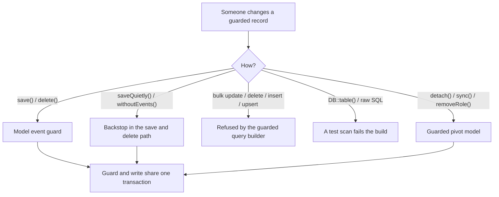
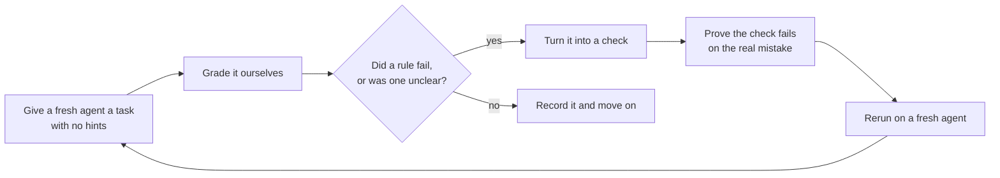

# How ShipKit was built for agents

ShipKit is the Laravel starter we use as the foundation of every new project. More and more of the code in those projects is written by coding agents, and agents have a particular weakness: they only see the files they opened. A rule that lives in someone's head, or in a paragraph nobody reads, is a rule an agent can break without anything turning red.

This is the story of how we reshaped ShipKit so that an agent who knows nothing about it ends up doing the right thing, and how we checked that claim by letting agents loose on it and watching where they stumbled.

> [!NOTE]
> This document describes how the template itself was built. Projects created from ShipKit inherit it because it explains why the structure looks the way it does. Delete or replace it once your project has its own story.

<details>
<summary><strong>Words used here</strong></summary>

- **Bounded context**: a folder of code that shares one business vocabulary, such as "access control" or "settings".
- **Aggregate**: a record that owns its own rules. In ShipKit that is an Eloquent model.
- **Invariant**: a rule that must always be true, such as "the last super admin can't be removed".
- **Guard**: code that refuses a change which would break an invariant.
- **Worktree**: a second checked-out copy of the repository in its own folder, so several agents can work at once without touching each other.
- **Unaided agent**: a coding agent given a task with no hints about how the codebase is organised.

</details>

## The short version

- Code is organised into **three bounded contexts** (`AccessControl`, `Settings`, `Authentication`) plus a small shared kernel.
- Business rules live on the models and **can't be skipped**: not with `saveQuietly()`, not with bulk updates, not with raw SQL, not through relationship helpers.
- **An enforcement table pairs 29 rules with the check that enforces each.** One is only partly enforced, and says so.
- We tested the result with **seven unaided agent runs**. Every gap they found became a check or a clearer rule.

|                                                |                                                  |
| ---------------------------------------------- | ------------------------------------------------ |
| Commits in the architecture work               | 18                                               |
| Files changed                                  | 194 (+5,947 / −417)                              |
| Bounded contexts                               | 3, plus a shared kernel                          |
| Guarded models                                 | 5 (`Role`, `Permission`, `User`, and two pivots) |
| Rules with a named enforcer                    | 29                                               |
| Project skills                                 | 14                                               |
| Tests                                          | 218 (672 assertions), in about 3 seconds         |
| Unaided agent runs                             | 7                                                |
| Ways around a protected rule, found and closed | 8                                                |

The work was done in one long session with Claude Code. The evaluation agents were Claude subagents.

## 1. The bet

We started from an idea: a structure that feels like overkill to a person can be exactly right for an agent.

A developer who knows the codebase carries its rules in their head. An agent doesn't. It sees the files it opened, copies the nearest example, and takes the shortest path that compiles. If a rule exists only as a sentence in a document, nothing fails when the agent ignores it.

So we ranked the ways of keeping a rule true, strongest first:

1. **Make the mistake impossible**, through the shape of the code.
2. **Make it fail the build**, with types or an architecture test.
3. **Test the behaviour.**
4. **Write it down**, last, and only for judgment calls.

That ladder comes from `/correct`, a skill in Cursor's [pstack](https://github.com/cursor/plugins/tree/main/pstack), and it drove nearly every decision below.

## 2. The decision: full DDD, or DDD-lite

We began wanting full domain-driven design: separate domain entities, repositories, mappers. Before committing, we drew both versions using ShipKit's real classes and compared them.

|                                         | DDD-lite (chosen)                      | Full DDD                                         |
| --------------------------------------- | -------------------------------------- | ------------------------------------------------ |
| Files for a feature like `Role`         | about 9                                | about 17                                         |
| Where a rule lives                      | On the Eloquent model, or in an Action | On a separate entity, with a mapper to the model |
| Files an agent edits per change         | 1–2                                    | 3–5 (entity, mapper, repository, use case)       |
| Fits Fortify, Sanctum, Spatie, the Gate | Yes, they all use Eloquent models      | Needs a second copy of every model, kept in sync |
| README principle "start Laravel-native" | Kept                                   | Strained                                         |

Fortify, Sanctum, Spatie Permission, and Laravel's Gate all work with Eloquent models. A separate entity would mean two representations of every record, and two things that an agent must keep in sync is exactly the kind of thing agents get wrong.

Most of what DDD gives you, one home for each rule, real types for concepts, a shared vocabulary, doesn't need the extra layers. So ShipKit takes those ideas and stops there: **no repositories, no mappers, no separate entities.**

## 3. What we built

Writes and reads each take one short path.



The code is grouped by what it is about, not by what kind of file it is:

```text
app/Domain/
├── AccessControl/    roles, permissions, protected system records
├── Settings/         profile, password, passkeys, account deletion
├── Authentication/   API login, two-factor, tokens, verification
└── Shared/           the kernel: DomainException and the guard traits
```

Each context holds its own Actions (writes), Queries (reads), Models, Policies, and Exceptions. A context's Actions, Queries, and exceptions are its **public surface**: other contexts may call them. Its models, enums, policies, and services are **internal**.

A context has one name everywhere: `app/Domain/Settings`, `app/Http/Controllers/Settings`, `tests/Feature/Settings`. An architecture test fails on a folder that doesn't match a context, so an agent can find everything about "settings" by searching for the word.

Adding a context is one command:

```bash
php artisan make:context Billing
```

It creates the folders, the rule file the agent will read, its row in the rules index, and the test folder. The architecture tests discover the new context on their own.

## 4. Rules that can't be skipped

Take a rule like "a protected role can't be deleted" or "the last super admin can't lose the role". We want it true however the change is made: from a controller, a job, a seeder, or a stray `tinker` session.

We first put such rules in the model's own save and delete hooks. Then we kept looking for ways around them, and kept finding some:

| Way around the rule                                                                        | What stops it now                                                                     | How we found it          |
| ------------------------------------------------------------------------------------------ | ------------------------------------------------------------------------------------- | ------------------------ |
| `saveQuietly()`, `deleteQuietly()`, `withoutEvents()`, a seeder using `WithoutModelEvents` | The guard also runs from the save and delete path when events are silenced            | Our own probe            |
| `Role::query()->update()`, `delete()`, `upsert()`                                          | A guarded query builder refuses bulk writes                                           | Designing the fix above  |
| `DB::table('roles')` or raw SQL                                                            | A test scans for writes to guarded tables, which it discovers from the models         | Our own review           |
| `revokePermissionTo()`, `removeRole()`, `syncRoles([])`                                    | Guards on pivot models, attached on both sides of the relation                        | An unaided agent         |
| `create()` past a limit, `createQuietly()`, `Model::insert([...])`                         | `guardCreate()` runs for every way of inserting a model, and bulk inserts are refused | An unaided agent (Notes) |
| Two requests at once                                                                       | The guard and the write share one transaction, and the guard locks the rows it counts | The same agent           |



The relationship guards were not a theory. When we tested the previous commit, **all eight ordinary ways of breaking these rules succeeded without an error**:

- a protected role losing a protected permission through `revokePermissionTo()`, `permissions()->detach()`, `syncPermissions([])`, or with model events silenced;
- the only super admin losing the role through `removeRole()`, `syncRoles([])`, or `roles()->detach()`;
- that same user being deleted outright.

Any one of them locks everyone out of access control, which is the exact thing protected records exist to prevent.

## 5. How we evaluated it

A rule that reads well can still fail an agent. We wanted evidence, so we did what you'd do with a new hire: give them a real task, say nothing about how the codebase works, and watch where they get stuck.

**The method**

1. **A fresh agent in its own worktree**, cut from the exact commit under test. Dependencies are cloned into it, never symlinked (see [the mistakes](#7-mistakes-we-made-and-caught)).
2. **A task written the way a user would write it**: what the feature must do, with no hints about folders, rules, or skills. For example: "A team must always keep at least one owner: the last owner can't leave, be removed, or be demoted, no matter how that's attempted."
3. **The same report questions every time**: files changed, commands run, where it looked and in what order, anything confusing, every failing check and whether the message alone said how to fix it, and any rule it broke or nearly broke because nothing stopped it.
4. **Grading it ourselves.** We don't trust the report. We run `composer ci:check`, diff the check files to see whether any were weakened to get green, read the code for security problems, and try to break its rules from outside.
5. **Verifying every claim on a clean checkout.**
6. **Turning each gap into a check**, and proving the check fails on the real mistake before trusting it.



**The seven runs**

Round 1 asked: does the structure matter?

| Run | Task                               | Result                                                                                                                                                                                          |
| --- | ---------------------------------- | ----------------------------------------------------------------------------------------------------------------------------------------------------------------------------------------------- |
| 1   | Teams, on the **old** architecture | Built flat code with the last-owner rule only inside Actions, so raw Eloquent writes could still break it. Had to invent how team owners are authorized.                                        |
| 2   | Teams, on **DDD-lite**             | Found `make:context`, put the rule on the model with a row lock, wrote tests that attack the rule directly, and proved the feature in the running app. 212 tests passing. Also exposed 10 gaps. |

Round 2 asked: does it hold up on different kinds of work?

| Run | Task                                               | What it stressed                             | Result                                                                                 |
| --- | -------------------------------------------------- | -------------------------------------------- | -------------------------------------------------------------------------------------- |
| A   | Role descriptions                                  | Changing an existing context                 | Correct. Only friction.                                                                |
| B   | Audit trail for roles and permissions              | A cross-context feature and a new permission | Correct, but put a feature permission where only recovery permissions belong.          |
| C   | A Users page that never loses the last super admin | A rule on a vendor package's pivot table     | Correct, but had to improvise the pivot guard. Flagged privilege escalation and races. |
| D   | API token management                               | API conventions and secrets                  | Secure and correct, but missed throttling on the new write routes.                     |

Round 3 asked: did we cut too much? After a skills audit trimmed the always-loaded guidance by about 40%, one more fresh agent worked from only the trimmed `CLAUDE.md`.

| Run   | Task                                                 | What it stressed                                             | Result                                                                                                                                                                                                                                |
| ----- | ---------------------------------------------------- | ------------------------------------------------------------ | ------------------------------------------------------------------------------------------------------------------------------------------------------------------------------------------------------------------------------------- |
| Notes | Private notes, at most 50 per user, strictly private | Whether the trimmed guide still leads to the right structure | Scaffolded a context, put the limit on the model with a lock, hid other users' notes behind 404s, and passed every check. It needed nothing the trim removed. It did find that a creation-time limit had no home in the guard kernel. |

All seven finished with `composer ci:check` passing, and none weakened an existing check. The value was in what they ran into.

## 6. What the agents taught us

The ten most telling findings. The full log is in the [appendix](#appendix-the-full-findings-log).

| What an agent hit                                                   | What changed                                      | The check that keeps it fixed                                   |
| ------------------------------------------------------------------- | ------------------------------------------------- | --------------------------------------------------------------- |
| The boundary test banned cross-context calls that the docs allow    | Split a context into internals and public surface | Per-context rules in `ArchitectureTest`                         |
| Factories in a domain folder resolved to the wrong model            | A resolver, plus a rule file for factories        | `DomainFactoryResolutionTest`                                   |
| No one could say where a feature permission belongs                 | A written criterion for the reserved enum         | A pinned list that fails when it grows                          |
| Nothing said how an Action learns who is acting                     | The actor is an explicit `$actor` parameter       | `ArchitectureTest` bans `auth()` and `request()` in the domain  |
| New write routes had no throttling (and `logout` never had any)     | An `api-write` limiter                            | `ApiRouteConventionsTest`                                       |
| Looking up records by URL binding can expose other users' records   | Look up through the actor                         | `ApiRouteConventionsTest`                                       |
| A typo in a permission string silently hides a menu item            | None needed                                       | `FrontendPermissionsTest` compares them with seeded permissions |
| Relationship helpers bypassed the protected-record rules            | Guarded pivot models                              | `RelationshipInvariantsTest` (18 tests)                         |
| Tests failed with "Vite manifest not found" in a fresh checkout     | Tests skip the asset build                        | The whole suite runs with no build                              |
| `ci:check` stops at its first failure and needs two tools to repair | `composer fix`                                    | None needed                                                     |

## 7. Mistakes we made, and caught

These are part of the story, because they show why the process looks the way it does.

**The test that couldn't fail.** We wrote tests for the eight bypass paths, watched them fail, and called the holes confirmed. They failed, but not for the reason we thought: the test framework handed our test closures over unevaluated, so no test ever attempted a removal. We noticed when they kept failing after we'd built the fix. We repaired the tests, then re-checked the previous commit in a clean checkout with a probe that records whether each path throws. All eight really were open. A check you haven't seen fail _and_ pass for the right reason isn't evidence.

**The symlink that rewrote our autoloader.** We told the first agent to symlink `vendor/` into its worktree. Its `composer dump-autoload` regenerated the main checkout's autoloader from the worktree. The agent reported it, we repaired it, and every later run cloned `vendor/` instead.

**Documents that were right but looked wrong.** Agents said `CLAUDE.md` contradicted the code. The committed file was fine. They had been given the copy loaded when our session started, before we regenerated it. That artefact of editing while evaluating can't happen in a fresh clone, but it is why a test now fails when `CLAUDE.md` drifts from its source.

**Ten minutes for a three-second suite.** Inertia's server-side rendering was switched on in tests, and a stale `public/hot` file pointed it at a dev server that wasn't running. Every page test waited about 30 seconds. The suite went from roughly ten minutes to under three seconds.

**Shipping the thing we hadn't tested.** After everything was merged, we created a project with the real installer, the same command a user would run. It found two gaps nothing else had. New projects got the skill sources but not the generated skills the agents actually load, because the installer never ran `boost:update`. And an unanchored `README.md` rule in `.gitattributes` silently dropped a skill's index file from every archive; the generated project's own test caught it on its first run. Both are fixed, and a test now compares the archive against the tracked files.

**Smaller ones.**

- A rule that read backwards: "foreign keys into guarded tables use `restrictOnDelete()`" was taken by an agent to mean the opposite direction. It's now a rule plus a check that asks for a recorded reason for any cascade.
- A skill we nearly lost: we excluded Boost's `infer-conventions` as redundant, on the reasoning that ShipKit states its conventions explicitly. Then we read what it does: it finds a project's own conventions and records them as rules, skipping what is already recorded, so it is useful to every project built from ShipKit once it grows house patterns. It costs no context unless typed, and with the Copilot copies gone it adds nothing to the repository. We put it back.
- Two names for one thing: we called a context `Account` while the routes, controllers, and pages said `Settings`. An agent hit it, and we renamed it.

## 8. The numbers

|                                      | Before                               | After                                                |
| ------------------------------------ | ------------------------------------ | ---------------------------------------------------- |
| Full test suite                      | about 10 minutes                     | about 3 seconds                                      |
| Tests                                | 152 when the refactor landed         | 218                                                  |
| Rules tied to a check                | none                                 | 29                                                   |
| Known ways to break a protected rule | 8                                    | 0 known                                              |
| Project skills                       | 0                                    | 14                                                   |
| Always-loaded `CLAUDE.md`            | about 9,100 tokens                   | about 5,500 tokens                                   |
| Agent setup in a fresh clone         | none (gitignored, installed by hand) | committed, and `composer setup` generates the skills |

## 9. What is still open

We would rather say this plainly than let the numbers above flatter us.

- **Privilege escalation is documented, not enforced.** Someone allowed to assign roles could grant themselves super admin. ShipKit ships no role-assignment screen, so there is nothing to test yet. The requirement is written down for whoever builds one.
- **Concurrency is only partly proven.** A test confirms that a guard and its write share one transaction. SQLite ignores row locks, so we have never seen two real requests collide.
- **The round-2 agents never ran the app.** All four stopped at the test suite, though a skill for driving the running app exists. Only the Teams run used it. What an agent proves is mostly what its task asks for.
- **The round-2 agents used no skills.** They were steered by the path-scoped rules and by the checks. Only the Teams run reached for skills (`new-context`, `domain-modeling`, `verify-app`), because its task matched them. The skills may matter less than we assumed.
- **Several checks are pattern-based.** Controller and route authorization parse real code. Others scan source with regular expressions, which unusual code can slip past.
- **The evidence is seven runs** on one small codebase, by the same model family that helped build it. More varied tasks are the obvious next step.
- **It is merged to `main` but not yet pushed or tagged.**

## 10. Run the evaluation yourself

<details>
<summary><strong>The recipe</strong></summary>

**1. One worktree per run, from the commit under test.**

```bash
git worktree add -b eval/my-task .claude/worktrees/eval-my-task main
W=.claude/worktrees/eval-my-task
cp -Rc vendor "$W/vendor"            # clone it, never symlink it
cp -Rc node_modules "$W/node_modules"
cp .env "$W/.env"
cd "$W" && composer dump-autoload && npm run build && php artisan boost:update
php artisan test --compact           # it must start green
```

`cp -Rc` clones on macOS (APFS). On Linux use `cp -a --reflink=auto`.

**2. Give the task, written like a user would.**

```text
You are working in the git worktree at <path>. Work only there. Dependencies are installed.
Implement the feature below as a senior engineer would for this codebase, then report back.

## The feature
<what it must do, with no hints about folders, rules, or skills>

Write the tests it deserves. Make the project's checks pass. Do not push or commit.

## Report back
1. Files created or changed.
2. Commands run and their results.
3. Where you looked to learn how this codebase works, in order.
4. Anything confusing, contradictory, or missing.
5. Every failed check, and whether its message alone told you the fix.
6. Any rule you broke or nearly broke because nothing stopped you.
```

**3. Grade it yourself.**

- Run `composer ci:check`.
- Diff the check files (`tests/Unit`, `tests/Feature/*Test.php`) for weakened assertions.
- Read the diff for security: other users' data, secrets in responses, unthrottled writes.
- Try to break its rules from outside: bulk writes, silenced events, relationship helpers.
- For each friction point, ask whether a check can replace a sentence.
- Before trusting a new check, break the code on purpose and watch it fail.

**4. Clean up.**

```bash
git worktree remove --force .claude/worktrees/eval-my-task
git branch -d eval/my-task
```

</details>

## 11. Lessons

1. **Enforce, don't describe.** A rule nothing checks is a suggestion.
2. **Verify your verifiers.** Watch a check fail on a real violation before you rely on it.
3. **Test with agents that know nothing.** The ones who've read your docs hide the gaps.
4. **Fix the foundation, not the agent.** Each time an agent stumbled, the codebase changed, not the prompt.
5. **Keep the reason with the check.** A failure message that names the fix is documentation that can't go stale.
6. **Say what is unproven.** It's what makes the rest believable.

Ideas borrowed along the way, both MIT licensed: [mattpocock/skills](https://github.com/mattpocock/skills) and Cursor's [pstack](https://github.com/cursor/plugins/tree/main/pstack). Their skills are adapted to ShipKit's conventions in `.ai/skills/`, each with its upstream license.

## Appendix: the full findings log

<details>
<summary><strong>29 findings, with what changed and what keeps each one fixed</strong></summary>

"Rule only" means the fix is written down but nothing enforces it.

| #   | Finding                                                                                                             | Found by           | What changed                                                                      | Check                                                |
| --- | ------------------------------------------------------------------------------------------------------------------- | ------------------ | --------------------------------------------------------------------------------- | ---------------------------------------------------- |
| 1   | Boundary test banned cross-context calls the docs allow                                                             | Run 2              | Internals vs public surface                                                       | `ArchitectureTest`                                   |
| 2   | Factories blocked by the same boundary rule                                                                         | Run 2              | Factories allowed                                                                 | `ArchitectureTest`                                   |
| 3   | Domain-folder factories resolved to the wrong model; a skill said otherwise                                         | Run 2              | Resolver in `AppServiceProvider`, factories rule                                  | `DomainFactoryResolutionTest`                        |
| 4   | Exceptions were "internal" but thrown across contexts                                                               | Run 2              | Exceptions are public surface                                                     | `ArchitectureTest`                                   |
| 5   | Policy rule couldn't express team-owner authorization; no 404 vs 403 guidance                                       | Runs 1, 2          | Membership exception, "hide records" rule                                         | Rule only                                            |
| 6   | A refused account deletion logged the user out and lost the error                                                   | Runs 1, 2          | Delete before logout                                                              | `ProfileTest`                                        |
| 7   | Guards defeated by `saveQuietly()` and `withoutEvents()`                                                            | Our probe          | Backstop in the save and delete path                                              | `AccessControlInvariantsTest`                        |
| 8   | Raw-write check used a hard-coded table list                                                                        | Our probe          | Tables discovered from guarded models                                             | `GuardedTablesTest`                                  |
| 9   | A fresh clone had no agent setup                                                                                    | Our review         | Setup committed, `composer setup` runs `boost:update`                             | Drift test in `AgentToolingTest`                     |
| 10  | Tests failed without a Vite build                                                                                   | Run 2, B, C        | `withoutVite()` in `TestCase`                                                     | The suite runs with no build                         |
| 11  | `ci:check` stops at the first failure; two tools to repair                                                          | A, D               | `composer fix`                                                                    | Tooling                                              |
| 12  | Wayfinder output is gitignored; `tsc` failed on a missing module                                                    | B                  | `ci:check` regenerates it                                                         | Tooling                                              |
| 13  | Where a feature permission belongs was ambiguous                                                                    | B, C               | Criterion in `.ai/rules/enums.md`                                                 | Pinned `SystemPermission` list                       |
| 14  | The cascade rule read backwards                                                                                     | B                  | Reworded; cascades need a recorded reason                                         | `GuardedTablesTest`                                  |
| 15  | No convention for how an Action learns who is acting                                                                | B                  | `$actor` parameter                                                                | `ArchitectureTest`                                   |
| 16  | New write routes lacked throttling; `logout` always had                                                             | D                  | `api-write` limiter                                                               | `ApiRouteConventionsTest`                            |
| 17  | Route model binding could expose other users' records                                                               | D                  | Look up through the actor                                                         | `ApiRouteConventionsTest`                            |
| 18  | A resource could list a secret                                                                                      | D, B               | None needed                                                                       | `ArchitectureTest`                                   |
| 19  | A mistyped permission string hides UI silently                                                                      | B, C               | None needed                                                                       | `FrontendPermissionsTest`                            |
| 20  | Relationship helpers bypassed protected-record rules (8 paths)                                                      | C                  | Guarded pivot models                                                              | `RelationshipInvariantsTest`                         |
| 21  | Two requests could both pass a "last one" check                                                                     | C                  | One transaction, row lock                                                         | Transaction test                                     |
| 22  | Missing conventions: paginated pages, single-record finder, seeding defaults, `Auth::forgetGuards()`                | A, B, D            | Documented                                                                        | Rule only                                            |
| 23  | Privilege escalation through role assignment                                                                        | C                  | Requirement documented                                                            | Not enforced                                         |
| 24  | Small: a launch script blocked its caller; partial naming; "run the full suite" note                                | Run 2              | Fixed                                                                             | Tooling                                              |
| 25  | A project made by the installer had no generated skills for Claude Code or Codex                                    | Real installer run | `boost:update` in `post-create-project-cmd`                                       | Verified by creating a project                       |
| 26  | An unanchored `.gitattributes` rule dropped nested `README.md` files from archives                                  | Real installer run | Anchored to the repository root                                                   | `TemplateArchiveTest`                                |
| 27  | A creation-time rule such as "at most 50 per user" had no home, and bulk inserts bypassed it                        | Notes run          | `guardCreate()`; `insert`, `insertGetId`, `insertOrIgnore`, `insertUsing` refused | `CreationInvariantsTest`                             |
| 28  | The always-loaded guidance repeated what path-scoped rules already say                                              | Skills audit       | Trimmed by about 40%; the review checklist moved into `review-diff`               | The Notes run built a feature from the trimmed guide |
| 29  | Committed Copilot copies of Boost skills in `.github/skills` shipped to every project and nothing kept them current | Skills audit       | Removed; Claude Code and Codex still get the skills from Boost                    | None needed                                          |

</details>
